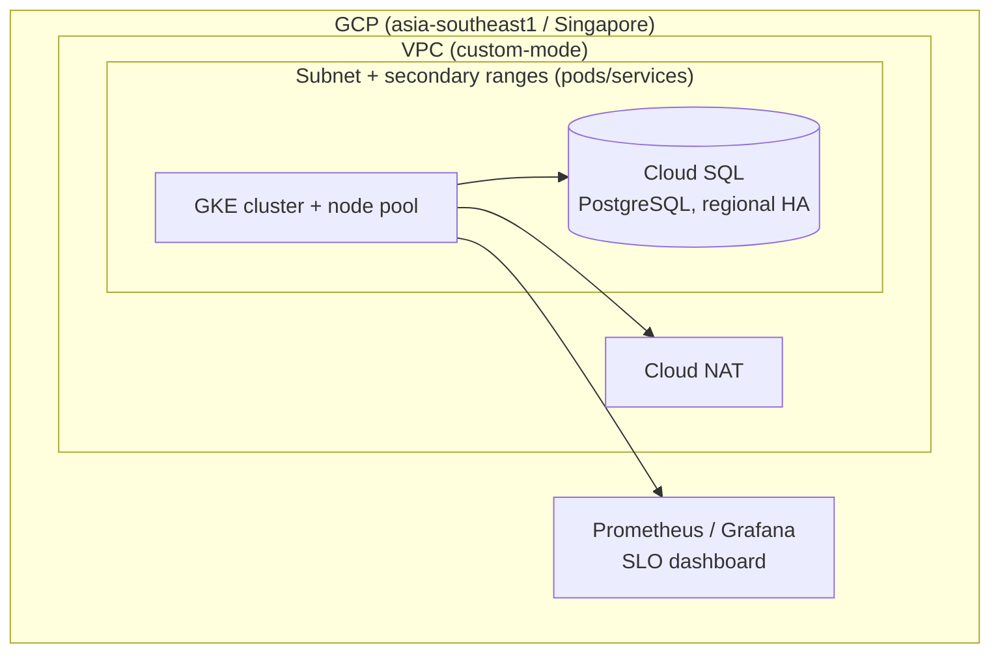

# terraform-healthcare-ai-gcp

Infrastructure-as-Code that reproduces a **healthcare-AI inference platform** on
Google Cloud using Terraform. Modeled on a real production stack (on-prem
Kubernetes + PostgreSQL HA + GPU inference) and rebuilt
cloud-native to practice Terraform, GCP (GKE / Cloud SQL), and CI/CD.

> **Note:** the application tier is a placeholder API — this repo contains no
> proprietary code or credentials.

## Architecture (target — built over 4 phases)



| On-prem (real stack) | GCP equivalent (this repo) |
|----------------------|----------------------------|
| microk8s             | **GKE** (managed Kubernetes) |
| PostgreSQL HA (pgpool/repmgr/Keepalived) | **Cloud SQL for PostgreSQL** (regional HA) |
| Docker Compose app   | Containerized API on GKE (placeholder) |
| VLAN / FortiGate     | **VPC** (custom subnet, secondary ranges, Cloud NAT) |
| server_health (health-check scripts) | **Prometheus / Grafana** + SLO dashboard (W4, planned) |
| GPU inference (T4)   | GKE GPU node pool (optional) |

## Roadmap

- **W1 — foundation** (this milestone): remote state (GCS), VPC + subnet (GKE-ready secondary ranges) + Cloud NAT, CI (`fmt`/`validate`/`tfsec`).
- **W2 — Kubernetes**: GKE cluster + node pool (VPC-native, attaches to the pods/services ranges).
- **W3 — data + app**: Cloud SQL (PostgreSQL), Secret Manager, placeholder API on GKE.
- **W4 — observability + polish**: Prometheus/Grafana, SLO dashboard, `plan` in CI via Workload Identity Federation.

## Layout

```
bootstrap/        one-time: create the GCS state bucket (local state)
modules/network/  VPC, subnet (pods/services secondary ranges), Cloud NAT
envs/dev/         wires modules; uses the GCS backend
.github/workflows terraform CI (fmt / validate / tfsec)
```

## Quick start (W1)

```bash
# 0. Prereqs (once)
#    - A GCP project with billing (new accounts get US$300 / 90-day free credit)
#    - Install Terraform (NOTE: `brew install terraform` no longer works —
#      HashiCorp is no longer in Homebrew core):
brew tap hashicorp/tap && brew install hashicorp/tap/terraform
#      On Linux (e.g. a GCE VM) OR if macOS Homebrew fails on Command Line Tools,
#      download the static binary directly (no compiler needed):
#        curl -fLO https://releases.hashicorp.com/terraform/1.15.8/terraform_1.15.8_linux_amd64.zip
#        unzip terraform_*.zip && sudo mv terraform /usr/local/bin/ && terraform -version
#    - Install the gcloud CLI: https://cloud.google.com/sdk/docs/install
gcloud auth application-default login          # ADC — the creds Terraform uses
gcloud auth login                              # gcloud CLI account (SEPARATE from ADC!)
#   On a GCE VM, gcloud defaults to the VM's limited service account, so `gcloud
#   services enable` fails with "insufficient authentication scopes" until you
#   run `gcloud auth login` as yourself.
gcloud config set project YOUR_PROJECT_ID
gcloud services enable compute.googleapis.com storage.googleapis.com   # W1 (add container/sqladmin for W2/W3)
#    Set a Budget alert in the console (Billing -> Budgets & alerts, ~US$30)

# 1. Create the remote-state bucket (local state, one time)
cd bootstrap
terraform init
terraform apply \
  -var 'project_id=YOUR_PROJECT_ID' \
  -var 'state_bucket_name=tfstate-<yourname>-healthcare-ai'
# -> note the `state_bucket` output

# 2. Point envs/dev at that bucket
#    edit envs/dev/backend.tf -> bucket = "<the bucket name>"
#    and:  cp envs/dev/terraform.tfvars.example envs/dev/terraform.tfvars   (set project_id)

# 3. Stand up the network
cd ../envs/dev
terraform init
terraform fmt && terraform validate
terraform plan
terraform apply

# 4. Tear down when done for the day (see Cost below)
terraform destroy
```

## 💰 Cost hygiene (also an SRE talking point)

Most of W1 is free (VPC + subnet cost nothing); **Cloud NAT** bills ~US$0.045/hr
while it exists, so run `terraform destroy` at the end of a session. After a full
teardown, idle cost ≈ $0 (only the GCS state bucket, a few cents/month).

- From W2, the GKE control plane and nodes bill per hour (one zonal cluster's
  management fee is free; node compute comes from your credit).
- Set a **Budget alert**. Everything runs inside your free-credit project.
- GPU node pools: start only when needed, destroy the same day.

## License

MIT (personal portfolio project).
